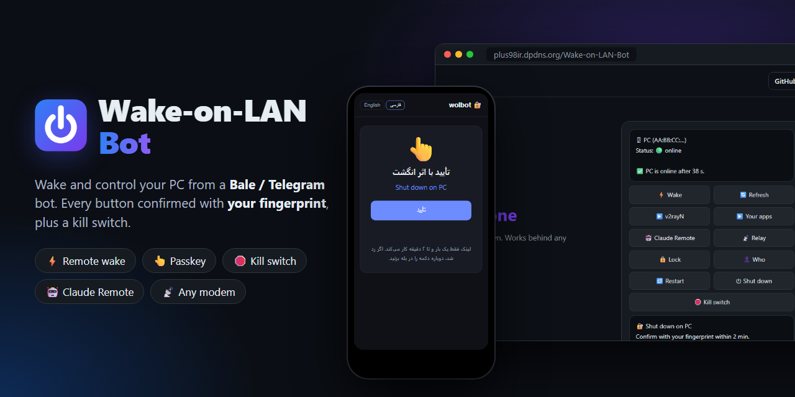

<p align="center"></p>

<h1 align="center">Wake-on-LAN Bot</h1>

<p align="center"><a href="https://hits.sh/github.com/Plus98ir/Wake-on-LAN-Bot/"></a> <a href="https://corenetbase.com/#support"></a></p>

<details>
<summary><b>☕ Support · حمایت</b> — USDT (TRC20) / TRX</summary>
<br>
<p align="center"></p>

```
TA53aFyGNfSAcrCaJi9QmA9x5W47nPJcf7
```

> [!WARNING]
> **TRON network only.** Sending from ERC20 / BEP20 will lose the funds.<br>
> **فقط شبکه‌ی TRON.** ارسال از ERC20 یا BEP20 پول را از بین می‌برد.

</details>

<p align="center">کامپیوترت را از روی گوشی روشن کن، کنترلش کن و همان لحظه که چیزی رویش تغییر کرد خبردار شو. اپ گوشی (PWA)، با ربات اختیاری بله یا تلگرام.<br>
<a href="https://corenetbase.com/Wake-on-LAN-Bot/">وب‌سایت</a> · <a href="../../releases/latest">دانلود</a></p>

<div align="center">
<table><tr><td><a href="https://github.com/Plus98ir/Wake-on-LAN-Bot/blob/main/README.md">🇺🇸 English</a></td><td><b>🇮🇷 فارسی</b></td></tr></table>
</div>

---

<div dir="rtl">

### چه کار می‌کند؟
- **روشن کردن** کامپیوتر خاموش از توی گوشی: با اپ نصب‌شدنی (PWA)، یا اگر بخواهی با بات بله و تلگرام.
- **کنترل** بعد از روشن شدن: اجرای برنامه‌هایی که خودت انتخاب می‌کنی (تا ۱۲ تا)، قفل، ری‌استارت، خاموش کردن، دیدن کاربر واردشده.
- **Claude Remote**: روشن کردن Claude Code Remote Control پشت صحنه، یا در پنجره‌ی VS Code که پشت کامپیوتر هم دیده می‌شود.
- **VS Code از هر جا** با Remote-SSH.
- **روشن کردن از بیرون روی بیشتر مودم‌ها**: WOL Agent پورت را با UPnP باز می‌کند (UDP و TCP). آی‌پی عمومی نداری (CGNAT، TD-LTE، ۴G)؟ یک رله‌ی کوچک داخل خانه بسته را می‌فرستد.
- **بدون پورت باز برای کنترل**: کامپیوتر خودش با تونل SSH به سرور وصل می‌شود.
- **اثر انگشت روی هر دستور** (Passkey) و خود کامپیوتر هم امضا را چک می‌کند، پس سرور هک‌شده نمی‌تواند چیزی روی آن اجرا کند.
- **نگهبان**: هر تغییری که بتواند راهی به کامپیوتر باز کند، صفحه را قفل می‌کند و از تو می‌پرسد. اسم فایل و امضایش را هم می‌گوید تا نصب خودت را از حمله تشخیص بدهی. تغییرهای خطرناک تا حدود ۱۵ ثانیه برگردانده می‌شوند.
- **هشدار با صدا روی گوشی**، حتی با اپ بسته.
- **کیل‌سوییچ** با صفحه‌ی بازیابی: رمز پشت کامپیوتر به‌علاوه‌ی اثر انگشت روی گوشی همه‌چیز را برمی‌گرداند.

### سه تکه دارد
| تکه | کجا | کارش |
|---|---|---|
| `wolbot` | سرور لینوکسی | اپ گوشی، بات اختیاری، اتصال، روشن کردن، کنترل و هشدارها |
| `WOL Agent.exe` | هر کامپیوتر ویندوزی | یک‌بار اجرا می‌شود: کامپیوتر را وصل می‌کند، تونل و دروازه و نگهبان را نصب می‌کند و پورت مودم را باز می‌کند |
| `wol-gate.exe` | هر کامپیوتر ویندوزی | امضای اثر انگشت هر دستور را چک می‌کند؛ نگهبان و صفحه‌ی بازیابی را اجرا می‌کند |
| مودم / روتر | خانه | بسته‌ی روشن‌کردن را به کامپیوتر می‌رساند (UPnP یا فوروارد دستی، رله، یا OpenWrt با SSH) |

### راه‌اندازی
این بخش راه‌اندازی با بات است. برای استفاده فقط با اپ، بخش «اپ گوشی» را ببین.

**۱. سرور (یک‌بار)**
```bash
git clone https://github.com/Plus98ir/Wake-on-LAN-Bot.git
cd Wake-on-LAN-Bot/src/server
sudo bash install.sh --token <توکن-بات> --public-host <آی‌پی-سرور>
```
- توکن را از [@botfather](https://ble.ir/botfather) در بله بگیر.
- به بات پیام بده؛ جواب می‌دهد `Your id: 123`. بعد: `wolbot admin 123 && systemctl restart wol-bot`
- اگر سرور فایروال دارد، پورت TCP **8790** را باز کن.

**۲. هر کامپیوتر (یک‌بار)**
1. BIOS: گزینه‌ی **ErP** = Disabled و **Power On By PCI-E** (یا Wake on LAN) = Enabled. کامپیوتر باید **با کابل** وصل باشد.
2. در اپ یا بات بزن **➕ Add PC**، برنامه‌ی **WOL Agent.exe** را اجرا کن، کد را بچسبان، یک **رمز بازیابی** برای کیل‌سوییچ انتخاب کن (بار اول اجباری است) و «نصب و اتصال» را بزن.
3. ورود خودکار ویندوز با [Autologon](https://learn.microsoft.com/sysinternals/downloads/autologon). صفحه بلافاصله قفل می‌شود.

**۳. مودم** — گزینه‌ی اول را WOL Agent خودش امتحان می‌کند و اگر نشد خبر می‌دهد:
- **آی‌پی عمومی و UPnP روی مودم (خودکار):** WOL Agent پورت UDP و TCP شماره ۹ را فوروارد می‌کند (یا 47009 اگر مودم پورت پایین را قبول نکند) و هر ساعت تازه‌اش می‌کند. کامپیوترهای جدید هم روشن کردن با UDP و هم TCP می‌گیرند؛ TCP برای شبکه‌هایی است که UDP را می‌بندند. وقتی کامپیوتر روشن است، سرور آی‌پی خانه را خودش دنبال می‌کند.
- **اینترنت TD-LTE / ۴G یا آی‌پی که مدام عوض می‌شود ← رله.** یک دستگاه همیشه‌روشن در همان خانه (گوشی اندرویدی قدیمی با [Termux](https://f-droid.org/packages/com.termux/)، رزبری‌پای یا یک کامپیوتر دیگر) بسته‌ی روشن‌کردن را از داخل خانه می‌فرستد. مودم تنظیم نمی‌خواهد. در بات روی کامپیوتر بزن **📡 Relay** و دستورهایی که می‌دهد را در Termux بزن. بعد در اعلان Termux «Acquire wakelock» را بزن و گوشی را به شارژ بزن.
- **آی‌پی عمومی بدون UPnP:** پورت **UDP 9** (و یا TCP 9) را به آی‌پی کامپیوتر فوروارد کن و آن آی‌پی را رزرو کن.
- **OpenWrt:** `wolbot add-wake <اسم> ssh <آدرس> <پورت> root br-lan`

> بعضی مودم‌ها چند دقیقه بعد از خاموش شدن کامپیوتر آدرسش را فراموش می‌کنند. اگر بعد از مدت طولانی روشن نشد، در مودم آی‌پی را به MAC ببند یا از رله استفاده کن. این مسیر به مودم بستگی دارد، پس یک بار تستش کن.

### اپ گوشی (PWA) - بدون بله و تلگرام
بعد از `wolbot auth https://auth.example.com` همان آدرس یک اپ نصب‌شدنی است: در Chrome یا Safari بازش کن، **Add to Home screen** بزن و با اثر انگشت وارد شو. همان دکمه‌های بات، وضعیت زنده هر ۵ ثانیه، اثر انگشت داخل خود اپ و فهرست رویدادها برای ادمین. اگر توکن بات خالی باشد، wolbot فقط به‌صورت اپ کار می‌کند.

**هشدار با صدا روی گوشی:** در اپ **🔕 هشدار خاموش** را بزن، اجازه بده و یک تست می‌رسد. از آن به بعد تغییرهای نگهبان، کیل‌سوییچ، درخواست باز کردن قفل، تأییدهای ناموفق، Passkey جدید و غریبه‌ها حتی با اپ بسته خبر داده می‌شوند. کارهای روزمره (ورود، اجرای برنامه‌ها) صدا ندارند. این Web Push است و محتوایش رمز شده، پس سرویس واسط آن را نمی‌بیند. روشن شدن هشدار روی دستگاه جدید هم خودش یک هشدار است.
- صدا همان صدای اعلان گوشی است: اپ وب نمی‌تواند صدای دیگری انتخاب کند یا از حالت بی‌صدا رد شود.
- هشدار ممکن است تا حدود ۳۰ ثانیه طول بکشد: سرور هر ۱۵ ثانیه کامپیوتر را چک می‌کند و کمی صبر می‌کند تا اسم فایل هم در پیام باشد. اگر اپ باز باشد، خودش هم بوق می‌زند.
- آیفون: اول **Add to Home Screen**، بعد اپ را از همان آیکون باز کن و زنگوله را بزن.
- سرور باید به سرویس‌های Push (گوگل، اپل، موزیلا، مایکروسافت) و گوشی به سرویس خودش دسترسی داشته باشد. اگر روشن کردن هشدار پشت VPN نشد، یک بار بدون آن امتحان کن.

**راه‌اندازی برای خودت**
1. سرور: `sudo bash install.sh --public-host <سرور>` (توکن بات لازم نیست)، یک دامنه با HTTPS به `127.0.0.1:8791`، بعد `wolbot auth https://auth.example.com && systemctl restart wol-bot`
2. گوشی: `wolbot admin 1` و `wolbot passkey-add Phone 1`، لینک را در گوشی باز کن و انگشت بگذار.
3. هر کامپیوتر: روی سرور `wolbot pair-code`، روی کامپیوتر **WOL Agent.exe** و چسباندن کد. دروازه‌ی کامپیوتر (پایین) نصب می‌شود و به Passkeyهای همان لحظه اعتماد می‌کند.
4. در گوشی `https://auth.example.com` را باز کن، **Add to Home screen** و ورود.

### دروازه‌ی کامپیوتر: خود کامپیوتر هر دستور را تأیید می‌کند
WOL Agent برنامه‌ی `wol-gate.exe` را نصب می‌کند و کلید سرور فقط می‌تواند همین را اجرا کند: نه shell، نه ترمینال، نه port forward. هر دستوری که چیزی را تغییر می‌دهد باید امضای تازه‌ی اثر انگشت روی **همان دستور، همان کامپیوتر، با زمان و عدد یک‌بارمصرف** داشته باشد و **خود کامپیوتر** آن را با Passkeyهایی که به آن‌ها اعتماد دارد چک می‌کند. سرور هک‌شده نمی‌تواند چیزی روی کامپیوتر اجرا کند. بدون امضا فقط این‌ها را می‌گیرد: روشن یا خاموش بودن، آی‌پی عمومی، اسم دکمه‌ها، روشن بودن Claude و هشدارهای نگهبان (چه چیزی عوض شده: اسم‌ها، مسیر فایل‌ها، امضاکننده‌ها)، و می‌تواند کیل‌سوییچ بزند یا یک تغییر را رد کند. پس در بدترین حالت می‌تواند کامپیوتر را قطع کند یا در اپ متن غلط نشان بدهد، ولی وارد نمی‌شود. پیام روی صفحه‌ی خود کامپیوتر از سرور رد نمی‌شود.
- هر درخواست در `C:\ProgramData\wol-agent\gate.log` ثبت و روی صفحه‌ی کامپیوتر نشان داده می‌شود؛ ۳ رد در ۱۰ دقیقه = کیل‌سوییچ به تصمیم خود کامپیوتر.
- **نگهبان** (تسک `WOL\Watch`، هر ۱۵ ثانیه): هر تغییر از جدول زیر صفحه را قفل می‌کند، روی کامپیوتر پیام می‌دهد، روی گوشی هشدار می‌فرستد و در اپ کارت می‌سازد. **تأیید با اثر انگشت** (خود کامپیوتر چک می‌کند) یا **رد** (کیل‌سوییچ می‌زند).

  | چه چیزی عوض شده | اگر جواب ندهی | خودش برمی‌گرداند؟ |
  |---|---|---|
  | ریموت دسکتاپ، UAC، فایروال | کیل‌سوییچ بعد از ۹۰ ثانیه | بله، تا حدود ۱۵ ثانیه به تنظیم تأییدشده |
  | ادمین‌ها، کاربرها، اجرای ابزار ریموت (AnyDesk، TeamViewer، RustDesk، Chrome Remote Desktop و...) | کیل‌سوییچ بعد از ۹۰ ثانیه | بله: عضو اضافه حذف، حساب جدید غیرفعال، ابزار بسته می‌شود |
  | کلیدهای SSH و تنظیمات sshd، Passkeyهای مورد اعتماد، ورود ناموفق به ویندوز | کیل‌سوییچ بعد از ۹۰ ثانیه | نه |
  | سرویس یا تسک جدید یا حذف‌شده | یک بار قفل می‌شود و بدون مهلت در اپ می‌ماند | نه؛ اگر خودت برگردانی هشدار بسته می‌شود |

- **می‌گوید چه چیزی عوض شده.** برای سرویس، تسک یا ابزار ریموت جدید، اسم، فایل، آرگومان‌ها، حساب اجراکننده و امضاکننده را می‌بینی، با یک نتیجه: **✅ شبیه نصب عادی** (امضای معتبر، داخل پوشه‌ی برنامه‌ها) یا **🚨 مشکوک** (بدون امضا یا امضای خراب، فایل پیدا نشد، بیرون از پوشه‌ی برنامه‌ها، یا برنامه‌ای که دستور اجرا می‌کند مثل PowerShell و `cmd` که امضای مایکروسافتش چیزی را ثابت نمی‌کند). مثلاً نصب Steam این‌طور نشان داده می‌شود: `new service "Steam Client Service", signed: Valve Corp.` این نتیجه فقط راهنماست، چون ابزار امضادار هم می‌تواند ناخواسته باشد. سؤال اصلی همیشه این است: «الان خودم این کار را کردم؟» اگر نه، رد کن.
- **تأیید فقط همان چیزی را می‌پذیرد که دیده‌ای.** هر چیزی که بعدش اضافه شود هشدار جدا می‌دهد و دوباره قفل می‌کند، پس چیزی پشت یک تأیید رد نمی‌شود.
- **رد** حتی برای یک تغییر کوچک کیل‌سوییچ کامل می‌زند و خود تغییر را پاک نمی‌کند: پشت کامپیوتر پاکش کن، وگرنه هشدار برمی‌گردد. برای چیزی که خودت نصب کرده‌ای، تأیید بزن.
- `wol-gate snapshot` چیزهایی را که زیر نظر دارد نشان می‌دهد و `wol-gate explain <services|tasks|remote> <اسم>` چیزی را که گزارش می‌کند. تاریخچه‌ی کامل در `gate.log` است.
- **بعد از کیل‌سوییچ**: یک صفحه‌ی قرمز تمام‌صفحه **رمز بازیابی** را می‌خواهد (جدا از ویندوز؛ در WOL Agent یا در ترمینال ادمین تعریفش کن: `C:\ProgramData\wol-agent\wol-gate.exe set-recovery`). رمز درست فقط اینترنت را برمی‌گرداند و درخواست باز شدن به اپ می‌فرستد؛ با اثر انگشت تأیید کن تا خود کامپیوتر امضا را چک کند و همه‌ی ارتباط‌ها و قفل سرور را برگرداند. ۵ رمز اشتباه = قفل ۱۵ دقیقه‌ای به بالا. بدون رمز یا با گوشی گم‌شده: `wol-unkill.ps1` با دسترسی ادمین و بعد `wolbot unlock`.
- فهرست: `wol-gate list`؛ گوشی جدید: ثبت روی سرور، بعد **WOL Agent ← Update**؛ حذف: `wol-gate untrust <اسم>`.
- هر کلید دیگری در `administrators_authorized_keys` راهی دور از دروازه است؛ فقط کلید دروازه را نگه دار.
- پیشنهاد (PowerShell ادمین): بستن همه‌ی اتصال‌های ورودی و روشن کردن UAC (دستورها در بخش انگلیسی).

### تأیید با اثر انگشت و کیل‌سوییچ (اختیاری، پیشنهادی)
وقتی روشن باشد، هر دکمه‌ای که کاری انجام می‌دهد (روشن، برنامه‌ها، قفل، Who، ری‌استارت، خاموش، Claude، Add PC، Relay، حذف) اول دکمه‌ی **🔐 Confirm with fingerprint** می‌دهد. لینک یک صفحه روی دامنه‌ی خودت باز می‌کند، گوشی اثر انگشتت را می‌خواهد (Passkey) و فقط بعد از آن دستور اجرا می‌شود. کسی که حساب بله‌ات را داشته باشد، بدون گوشی و انگشت تو کاری نمی‌تواند بکند.

یک دامنه با HTTPS روی سرور لازم است که به `127.0.0.1:8791` برسد:
```bash
wolbot auth https://auth.example.com
systemctl restart wol-bot
wolbot passkey-add Phone      # لینک یک‌بار مصرف را در گوشی باز کن و انگشت بگذار
```
در Caddy: `auth.example.com { reverse_proxy 127.0.0.1:8791 }`

- لینک تأیید **یک بار** و تا **۲ دقیقه** کار می‌کند و فقط برای همان دستور روی همان کامپیوتر است.
- **کیل‌سوییچ**: ۳ تأیید ناموفق در ۱۰ دقیقه یا زدن دکمه‌ی **🛑 Kill switch** (اثر انگشت نمی‌خواهد): بات همه‌چیز را می‌بندد و کامپیوترها قفل می‌شوند، تونل و SSH خاموش و کارت شبکه قطع می‌شود. برگشت: پشت کامپیوتر `C:\ProgramData\wol-agent\wol-unkill.ps1` را با دسترسی ادمین اجرا کن، بعد روی سرور `wolbot unlock`.
- **ورود با اثر انگشت**: حتی ادمین قبل از دیدن هر چیزی باید با اثر انگشت وارد شود؛ ورود ۱۰ دقیقه اعتبار دارد. تغییر: `wolbot auth login <دقیقه>` یا `wolbot auth login off`.
- **دسترسی جدا برای هر کاربر**: ادمین همه‌کاره است؛ بقیه فقط دکمه‌ها و کامپیوترهایی را می‌بینند که تو تعیین کنی:
  ```bash
  wolbot user add <id> <اسم> wake,lock,who [PC1,PC2]   # wake apps claude lock who restart shutdown vscode | all
  wolbot passkey-add <اسم> <id>
  wolbot user list | user del <id>
  ```
  Add PC، رله، حذف کامپیوتر و کیل‌سوییچ فقط برای ادمین است.
- هر غریبه‌ای که به بات پیام بدهد به ادمین‌ها گزارش می‌شود.
- نفر دیگر: `wolbot admin <id>` و بعد `wolbot passkey-add <اسم> <id>`؛ هر کس با گوشی خودش تأیید می‌کند. باطل کردن: `wolbot passkey-del <اسم>`.
- گوشی ممکن است به‌جای اثر انگشت PIN قفل صفحه را هم قبول کند؛ پس PIN بلند بگذار، نه الگو. Passkey با حساب گوگل/iCloud همگام می‌شود؛ روی آن حساب 2FA بگذار.

### Claude از توی گوشی
دکمه‌ی **🤖 Claude Remote**، Claude را روی کامپیوتر در پوشه‌ای که در WOL Agent انتخاب کرده‌ای روشن می‌کند (Claude Code یا افزونه‌ی VS Code آن باید نصب و وارد حساب شده باشد). بعد از اپ Claude یا سایت claude.ai/code ادامه می‌دهی. دو حالت دارد: **پشت صحنه** که `claude remote-control` را مخفی اجرا می‌کند، و **VS Code** که پنجره‌ای با پنل Claude باز می‌کند و همان گفتگو در claude.ai/code هم دیده می‌شود. بار اول پشت کامپیوتر یک بار به پوشه اعتماد می‌کنی. **⏹ Stop Claude** آن را می‌بندد.

### استفاده
در اپ یا بات: ⚡ Wake (روشن) · 🤖 Claude Remote · ▶️ برنامه‌های انتخابی (اجرا) · 🔒 Lock (قفل) · ⏻ Shut down (خاموش) · 📡 Relay · ➕ Add PC (کامپیوتر جدید) · 🛑 Kill switch (قطع همه‌چیز)

</div>
